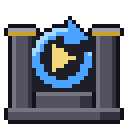
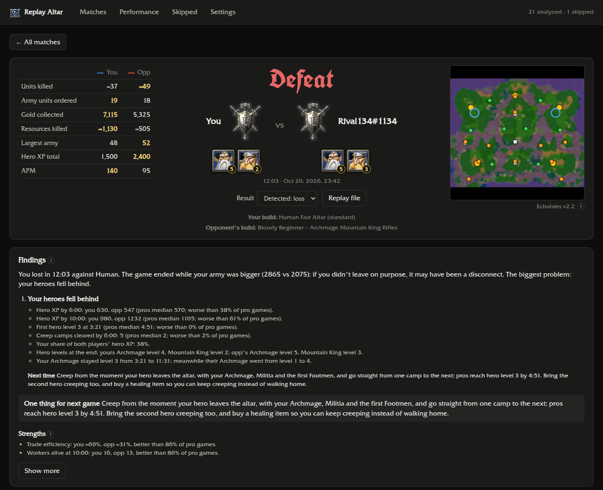
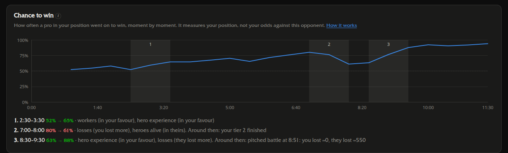
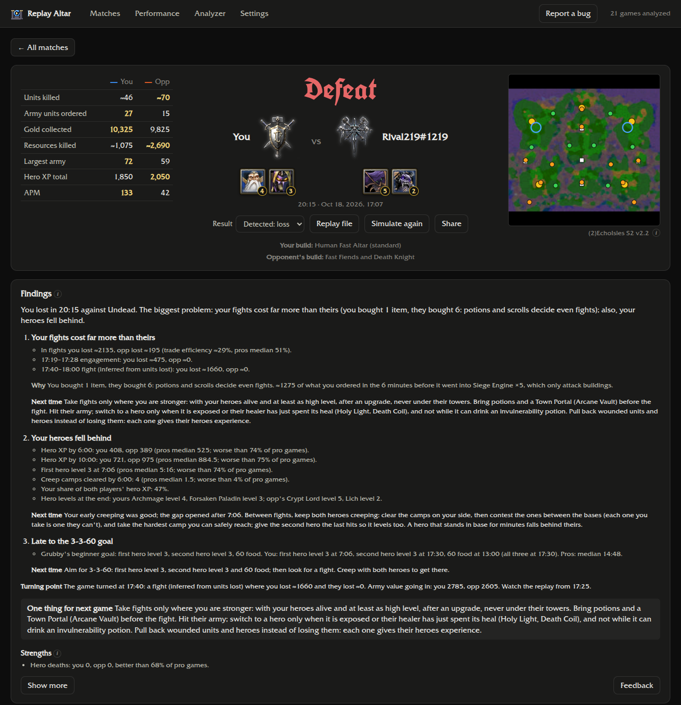
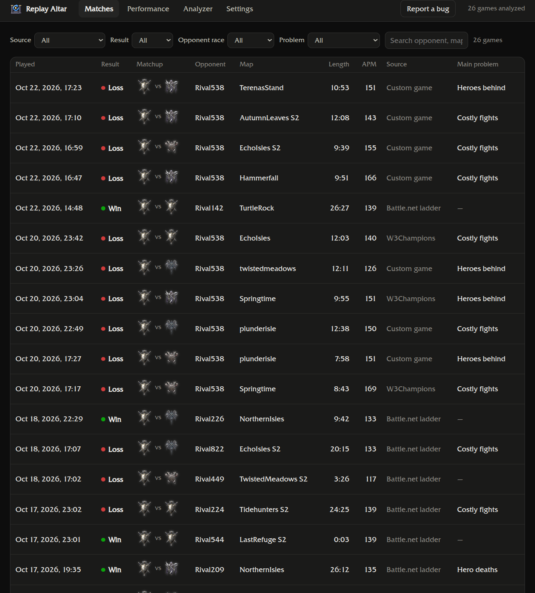
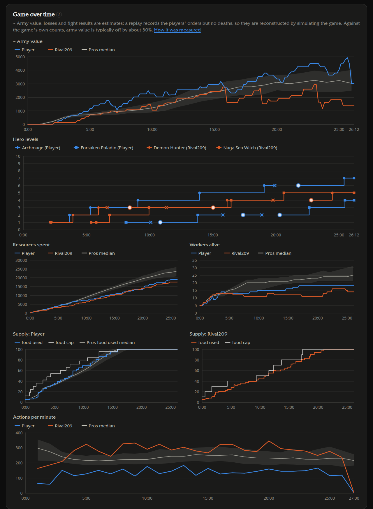
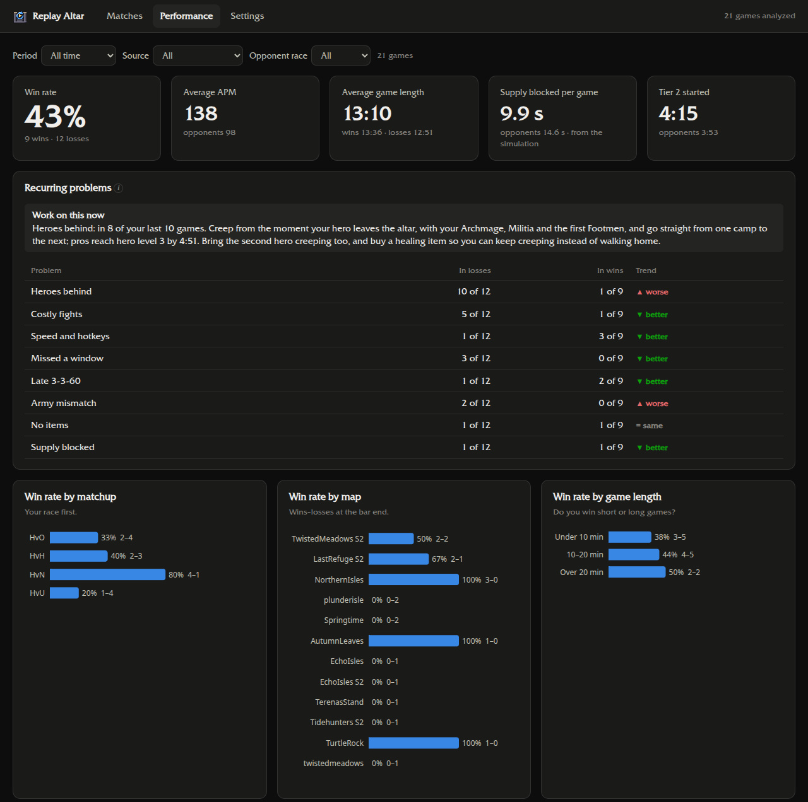
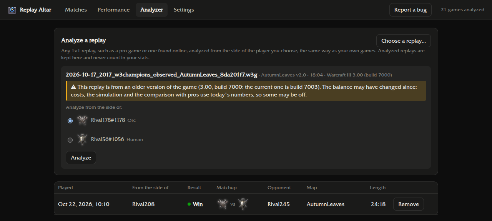
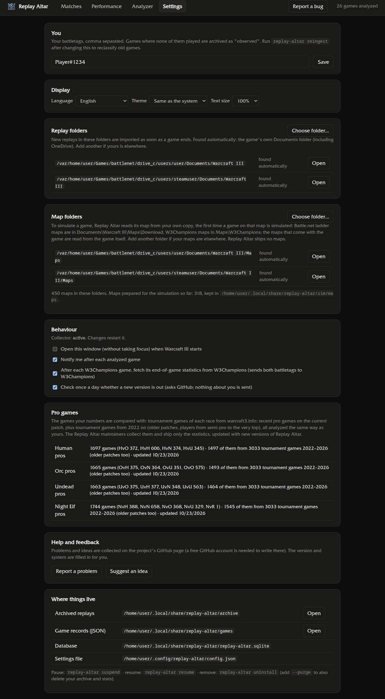

<p align="center"></p>

<h1 align="center">Replay Altar</h1>

Replay Altar is a Warcraft III: Reforged replay analyzer for 1v1 players. It runs on your own computer, keeps every game you play, and after each one tells you what decided it and what to do differently next time, compared with tournament players of your race. Everything it tells you is measured on real games: each finding, comparison and curve has been tested on thousands of tournament games, and the numbers are on this page.

[Download](https://github.com/bubunuh/replay-altar/releases)

- **Every replay kept, automatically.** A small background program saves each replay the moment a game ends, before the game overwrites `LastReplay.w3g`. It starts with your computer but only wakes up while Warcraft III runs (Settings can make it always on, or off). Battle.net ladder, W3Champions and custom melee games are all picked up, with nothing to upload or click.
- **The game reconstructed.** Each 1v1 is simulated from its replay with the [WC3V](https://github.com/jblanchette/wc3v) engine: workers, army value, supply, creep camps, hero levels and fights over time.
- **A coach's report after every game.** Rules drawn from well-known guides (Grubby, Liquipedia, Warcraft 3 Gym, Vortix and others) name the problems that cost you the game, show the facts behind each one, explain why it happened and say what to do next time. Only rules that proved themselves on 3,532 tournament player-games are shown: each one appears clearly more often in lost games than in won ones. The report also points out the fight that turned the game (with the moment to rewatch), your strengths and the opponent's plan. [More below](#how-the-report-is-made).
- **An evaluation curve, like in chess.** Who was ahead at every moment of the game, as how often a pro player in your position went on to win, with the three moments that swung it most and what moved them. Learned from 513 pro games and tested on 3,138 tournament games it had never seen. [More below](#the-evaluation-curve).
- **One thing to work on.** Each report ends with the single most useful habit for your next game. Across your recent games, the Performance page picks the problem that keeps coming back and shows whether it is getting better.
- **Every number in context.** Your numbers are placed among about 1,700 tournament games of your race and matchup ("better than 86% of pro games"), with a green, yellow or red verdict: at pro level, at least as good as your opponent, or behind both.
- **Knows your build.** It recognises the build order each player went for, from guide builds and builds mined from pro games, and shows where your timings drifted from the pros who play it.
- **Your progress.** Win rates by matchup, map and game length; problems that keep coming back; how you play in wins against losses; any number over time.
- **Any replay, not only yours.** The Analyzer tab analyzes a 1v1 replay you found, such as a pro game, from the side of the player you choose, without counting it in your stats.
- **Share a report** as text or as a PDF of the whole report, for Reddit or Discord, without your opponent's battletag.
- **Private and local.** Everything runs on your computer, with no account. In English, Brazilian Portuguese, Spanish and French.
- **Windows and Linux.** A Windows installer, and for Linux a single AppImage file.



Your games stay on your computer. Replay Altar fetches only two things from the internet, and Settings can turn off either: the game's own end-of-game statistics for your W3Champions games (a few small requests per game, one game at a time; they carry both battletags), and once a day the list of Replay Altar releases from GitHub, to tell you when a new version is out. The pro statistics come with the app, and no maps are shipped: each game's map is read from your own copy. See the [privacy policy](PRIVACY.md).

> Replay Altar is a fan project. It is not affiliated with, endorsed by or connected to Blizzard Entertainment. Warcraft is a trademark of Blizzard Entertainment, Inc. The game's data and pictures (unit costs, race crests, hero portraits, the game's font) are read from your own Warcraft III installation, never modified there, and never distributed with this project; the screenshots on this page only show them as the app displays them.

## How the report is made

**1. Reading the game.** A replay only records the players' orders, so Replay Altar rebuilds the game from them with the [WC3V](https://github.com/jblanchette/wc3v) simulation: workers, army, supply, creep camps, heroes and fights, every few seconds.

**2. comparing with tournament players.** Every number is placed among about 1,700 player-games of your race: recent pro games on the current patch plus tournament games from 2022 to 2026, analyzed exactly like yours. "Better than 86% of pro games" means just that: 86% of those games had a worse number.

**3. Deciding what mattered.** Each rule comes from a guide or from the pro data, and has to prove itself before it is shown. Every rule was run on 3,532 player-games whose results it had not been tuned on, from both players' side. A rule is shown only if it fires clearly more often in losses than in wins (the whole 95% confidence range above "no difference"). For example:

| Finding | Appears in lost games | Appears in won games |
|---|---|---|
| Your fights cost far more than theirs | 37% | 17% |
| Your heroes fell behind | 67% | 24% |
| You lost your heroes too often | 14% | 6% |
| No expansion in a long game | 7% | 3% |
| They had more bases than you | 21% | 13% |

10 rules passed and are shown (scored on 0.2.2's simulation; [docs/RULES.md](docs/RULES.md) has every rule's numbers). One check is shown whatever the result: playing without control groups or hotkeys.

In the future, suggestions will be skill based: during the analysis, the app will estimate your skill level and these suggestions will be more personal. <kbd>planned</kbd>

**4. What to do about it.** Each finding comes with the facts behind it, the likely reason found elsewhere in the game, and one concrete thing to do next time. Games of every race and level were also read by hand and compared with the report ([docs/REVIEWS.md](docs/REVIEWS.md)).

Every rule, its source and its scores: [docs/RULES.md](docs/RULES.md). The milestones mined from the pro games: [docs/PRINCIPLES.md](docs/PRINCIPLES.md).

## The evaluation curve



Each game's page shows an **evaluation curve**, like the ones chess sites draw under a game: blue while you were ahead, red while your opponent was, from the first minute to the last. At every moment, Replay Altar compares your position with your opponent's: food used (army and workers, as the game counts it), workers, hero experience, heroes alive, expansions, units lost and upgrades. Its height answers one question: **how often did professional players in that same position go on to win?** 50% is even. It learned the answer from 513 recent pro games.

How the graph works: every 30 seconds it compares you and your opponent on 7 things: food used (army size, as the game counts it), workers, hero XP, heroes alive, bases, upgrades, and how much each side has lost so far. Then it asks “when pros had this kind of lead or deficit at this minute, how often did they win?” The model is a logistic regression (basically a weighted score turned into a percentage), where the weights change over the game, since a worker lead matters differently at minute 5 than at minute 20. I fit it on 513 pro games and then tested it, without touching it, on 3,138 tournament games from 2022-2026 it had never seen. It picks the eventual winner 64% of the time at 10 minutes and 70% at 20. On unseen pro games its confidence is honest: when it says 70%, that side wins about 70% of the time. One thing to keep in mind: it shows how a pro would usually convert your position, so for regular ladder games it’ll look a bit overconfident. That’s on purpose, since a big drop means “a pro wouldn’t have lost this,” which is the point. Full write-up in docs/win-chance/report.pdf. 

**How it was made:** the [technical report (PDF)](docs/win-chance/report.pdf) describes the data, the model, how it was chosen and tested, its limits, and how to reproduce every number. The code, the fitted model and the list of games are all in this repository.

## Install

### Windows 10 or 11

1. Download `ReplayAltar-Setup-<version>.exe` from the [Releases](../../releases) page.
2. Run it. Windows will probably warn that it protected your PC, because the installer isn't digitally signed yet: click **More info**, then **Run anyway**.
3. The installer first shows what Replay Altar does on your computer (privacy, what runs in the background); click **I Agree**. It needs no administrator rights, installs for your user, adds a Start menu and desktop shortcut, and opens the app.

On the first start, in the background, Replay Altar reads the data it needs from your Warcraft III installation. It imports none of the replays already on your computer until you ask: the match list offers *Import 50 replays* (the newest) and *Import all replays*. It looks for the battletag that appears in most of your replays and asks you to confirm it (or type yours in Settings); until you do, nothing counts as yours. From then on a light background program starts with Windows and waits for the game: while Warcraft III runs it picks up each game as it ends, and once you close the game it simulates the new ones. **Settings → Behaviour** can make it run all the time, or only while Replay Altar's window is open (then the games you played meanwhile are picked up when you open it again; only `LastReplay.w3g`, which every game overwrites, can be missed). Simulations always wait until you close the game.

**Updates.** An update that changes how games are read (0.2.2 is one) starts the match list over in the same way: it offers to import your replays again, counting the copy Replay Altar keeps of every game it imported (for a game whose `LastReplay.w3g` was overwritten, the only copy left). Settings, battletag, game data, maps, results you corrected and W3Champions statistics stay; the previous database is kept as `replay-altar.previous.sqlite`.

- **Replays somewhere else?** It finds the game's `Documents\Warcraft III` folder by itself, OneDrive included. If yours is elsewhere, use **Settings → Replay folders → Choose folder…**.
- **Something wrong?** The log is in `%LOCALAPPDATA%\replay-altar\logs\collector.log`.
- **Uninstall:** Settings → Apps → Replay Altar. Your games and statistics stay in `%LOCALAPPDATA%\replay-altar`; delete that folder to remove everything.

### Linux (Battle.net under Wine or Lutris)

**AppImage**

1. Download `ReplayAltar-<version>.AppImage` from the [Releases](../../releases) page.
2. Make it executable (`chmod +x ReplayAltar-*.AppImage`, or Properties → Permissions in your file manager) and run it.

On its first start it sets up what the checkout's `install` sets up: the background collector as a systemd user service (started at login and awake while Warcraft III runs, or as chosen in Settings → Behaviour), the `replay-altar` command and a menu entry. It finds Battle.net in Lutris (`~/Games/…`), plain Wine (`~/.wine`), Steam's Proton prefixes and Bottles, and reads the game's data with a built-in read-only extractor (no podman needed). Keep the AppImage where you put it: the service runs it from there, and Settings → Updates replaces it in place. On distributions that block Electron's sandbox (Ubuntu 24.04 and later), it may need `--no-sandbox`.

**From a checkout**

Replay Altar can also run from a checkout of this repository. You need [Node.js](https://nodejs.org) 26 or newer, git and [podman](https://podman.io) (the game's data is read inside a container, through a throwaway overlay, so the game folder is never written to).

```sh
git clone --recurse-submodules https://github.com/bubunuh/replay-altar.git ~/Projects/replay-altar
cd ~/Projects/replay-altar
npm install
npm run build
node apps/collector/src/cli.ts setup-sim   # simulation engine and game data from your install
node apps/collector/src/cli.ts install     # background service, `replay-altar` command, desktop icon
```

`install` sets up the collector as a systemd user service and starts it, adds `replay-altar` and `replay-altar-desktop` to `~/.local/bin` and creates a desktop icon. The service starts at login and wakes up while Warcraft III (or the window) is open; Settings → Behaviour can make it always awake, or run only with the window. Your existing replays wait on the match list until you import them.

The default game location is the Lutris Battle.net prefix in `~/Games/battlenet`. For another location, pass the Warcraft III folder to `node scripts/extract-gamedata.ts <folder>` and add your replay folder in Settings.

## Using it

- **Matches:** every analyzed game, with its main problem. Open one for its report, charts, key numbers against pros, the build orders and a map of the fights and each player's creeping. **Feedback** under a game's findings tells us on GitHub whether they were right (the report is filled in, without player names), and **Report a bug** at the top opens a bug report.
- **Performance:** your win rates, recurring problems with the one to work on now, and your numbers in wins, losses and against pros.
- **Analyzer:** choose a replay file and the player whose side to take; the report opens like one of your games. Analyzed replays are listed there and kept apart from your stats.
- **Settings:** your battletags, language, light or dark theme, replay folders, map folders, when Replay Altar runs in the background, notifications, updates (a yellow mark on Settings when a new version is out; updating is your choice), which pro games your numbers are compared with, and **Help and feedback** to report a problem or suggest an idea.

Custom maps, games against the computer, team games and games you only observed are kept in the archive but not counted.

Player names in these screenshots are replaced with placeholders.

**A lost game:** the problems that decided it, with the facts, the reason behind each and what to do next time, the fight that turned it and the moment to rewatch.



**Matches**



**A game over time:** army value, hero levels, resources, workers, supply and APM, against the pro median, with a note on which numbers are estimates and how far off they typically are.



**Performance**



**Analyzer:** any 1v1 replay, from the side of the player you choose, with a warning when it comes from an older version of the game.



**Settings**



When Warcraft III starts, the window opens behind the game without taking focus, and a notification after each game opens its report. Both can be turned off in Settings; if Replay Altar runs only while its window is open (Settings → Behaviour), they only happen then.

### Commands (Linux, or a Windows checkout)

| Command | What it does |
|---|---|
| `replay-altar status` | Is the collector running, plus your last 10 games |
| `replay-altar suspend` / `resume` | Stop the collector and keep it from starting at login / start it again, at login too unless Settings → Behaviour says only with the window (it catches up on saved replays) |
| `replay-altar scan` | Import every replay in the game folders now |
| `replay-altar override <game> win\|loss` | Fix a wrong result (`<game>`: the first characters of the game key, or `latest`) |
| `replay-altar reingest` | Rebuild all statistics from the archived replays (after an update or a settings change) |
| `replay-altar report <game\|latest>` | The report of one game; `--facts` prints every number behind it |
| `replay-altar export --jsonl` / `--md latest` | Your data for a script or a spreadsheet |
| `replay-altar sim` | Simulation status; `--backfill`, `--retry-failed`, `--rerun`, `--resummarize` |
| `replay-altar official` | Fetch W3Champions' end-of-game statistics for games that lack them |
| `replay-altar uninstall [--purge]` | Remove the service, commands and icons; `--purge` also deletes your archive, statistics and settings |

### Where things are

| What | Linux | Windows |
|---|---|---|
| Archived replays (originals, never modified), game records, database, simulations | `~/.local/share/replay-altar/` | `%LOCALAPPDATA%\replay-altar\` |
| Settings | `~/.config/replay-altar/config.json` | `%APPDATA%\replay-altar\config.json` |
| Background service | systemd user unit `replay-altar-collector.service` (not enabled when it runs only with the window) | started at login from `HKCU\…\CurrentVersion\Run` (`ReplayAltarCollector`), or by the window when it runs only with the window |
| Collector log | `journalctl --user -u replay-altar-collector` | `%LOCALAPPDATA%\replay-altar\logs\collector.log` |
| Pro games (one folder per race) | `…/replay-altar/reference/` | `…\replay-altar\reference\` |

## How the analysis works

- **From the replay:** a replay records commands, not the game's state. Build times are when an order was given (cancelled orders included), and heroes are timed by their first learned skill. Results come from leave records; each shows its confidence and can be corrected by hand.
- **From the simulation:** workers, supply, army value, creep camps and fights come from WC3V's reconstruction of the game. Values marked ≈ are estimates: losses and trades (deaths are inferred), and the mined-income model, shown for the first 10 minutes only.
- **Maps:** the simulation needs each game's map. Replay Altar ships none: the first time a game on a map is simulated, it reads the map from your own copy (the game keeps Battle.net ladder maps in `Documents\Warcraft III\Maps\Download` and W3Champions maps in `Maps\W3Champions`; the maps that come with the game are read, read-only, from the game's own files; Settings → Map folders adds others) and keeps what the simulation needs in its data folder, so updates don't lose it. **Simulate again** on a match runs a game's simulation again, for example after adding a map folder.
- **Official numbers:** for W3Champions games, the game's own end-of-game statistics (gold and lumber collected, experience, units killed, upkeep lost) replace the estimates and are marked "official".
- **Pro games:** tournament games from [warcraft3.info](https://warcraft3.info/replays/), collected by the maintainers rather than by each copy of the app, so the site gets one slow download per game instead of one per user. About 200 per race are recent games on the current patch: 1v1 games of at least 3 minutes by players with a curated profile, at most 20 per player. To these are added about 3,000 tournament games from 2022 to today, spread over the years and matchups, of players from semi-pro to the very top, on older patches too; every player of a race in them counts, which makes about 1,700 player-games per race. More games make the comparisons steadier; the price is a mix of patches and levels (on most numbers the medians differ by under a third of the pros' normal range). All are analyzed the same way as yours, and only the resulting statistics are published, in `data/reference/`, updated with new versions of Replay Altar.
- **Verdicts:** the main numbers get a colour: green at or above the pro median, yellow when at least as good as your opponent, red below both. Timings that depend on strategy (tier, heroes, expansions) are compared without a better or worse.
- **Findings:** see [How the report is made](#how-the-report-is-made); [docs/RULES.md](docs/RULES.md) lists every rule, where it comes from and how well it separates losses from wins. [docs/PRINCIPLES.md](docs/PRINCIPLES.md) holds the milestones mined from the pro games; [docs/DATA.md](docs/DATA.md) describes the data format.

After a game patch, run `node scripts/extract-gamedata.ts` and `node scripts/extract-combat.ts` (Linux checkout) so unit costs and combat data follow the new balance, then update the pro games. The Windows version reads the game data again by itself.

## Development

```sh
npm test               # vitest
npm run typecheck
npm run build          # the desktop app (apps/desktop/out)
npm start -w @replay-altar/desktop
node apps/desktop/package-windows.ts   # Windows installer (built on Linux; needs wine on PATH)
node apps/desktop/package-linux.ts     # Linux AppImage
```

The code is TypeScript run directly by Node (type stripping), in npm workspaces:

| Package | What it holds |
|---|---|
| `packages/core` | Replay parsing ([w3gjs](https://github.com/PBug90/w3gjs)), classification, metrics, the database, settings, languages |
| `packages/sim` | The WC3V simulation and the economy model |
| `packages/reference` | Pro games: download, profiles, comparisons |
| `packages/rules` | Findings, advice, the report, build-order matching |
| `apps/collector` | The background collector and the `replay-altar` command |
| `apps/desktop` | The Electron app |

`fixtures/replays/` holds real replays used by the tests. Texts are written in place as `tr("English", "Português", "Español", "Français")` (`packages/core/src/i18n.ts`); metric names have a table per language (`packages/core/src/metrics.*.ts`).

**Branches and builds.** Work goes to `dev`; `main` only gets tested work. Every push runs the tests on GitHub, and every push to `dev` also builds a test Windows installer, and from 0.2.0 a test AppImage (Actions → the run → Artifacts). Pushing a version tag (`v0.2.1`) builds them again and puts them on a draft release, with the `latest.yml` (and `latest-linux.yml`) the app's Update button reads.

**WC3V changes.** The submodule `vendor/wc3v` points at an upstream WC3V commit; `patches/wc3v/` holds Replay Altar's changes on top of it, one `git format-patch` file per WC3V commit, applied in name order by `node scripts/patch-wc3v.ts` (run by `setup-sim`, the AppImage and Windows packaging and the GitHub build). The script checks the whole series against the submodule's commit before it writes anything and does nothing when it is already applied. Today's 26 patches are the WC3V lab's work: WC3V reads the replay's own selection lists (`lib/SelectionLedger.js`, `lib/HandleBinder.js`, `lib/SelectionEvidence.js`), so it knows which units exist and when they die, and a train order with several buildings selected trains in each of them (0001–0021); its data-tool reads the start locations of minified Lua maps (the copies hosted under hashed names) and optimised JASS maps (some ATR maps), which it stored at (null, null), so every game there stopped at 0:01, and a map entry without usable start locations names the map instead of failing in `Unit.recordPosition` (0022–0023, sent upstream as [#23](https://github.com/jblanchette/wc3v/pull/23)). A shift-click's selection list adds to the selection instead of replacing it, and an order given with nothing selected no longer stops the simulation (0024–0025). Night Elf train orders queue in the first selected Ancient only: copies the game refused for lack of gold became phantom units (0026). The entries already made from those maps, in WC3V's registry and in the copy every install keeps (`<data>/sim/maps/entries.json`), are repaired by Replay Altar at start and whenever a map is prepared for a simulation: their start locations are read again from the map's extracted script with WC3V's parser (`repairStartLocations` in `packages/sim/src/maps.ts`, `packages/sim/driver/start-locations.cjs`). The three earlier fixes (recycled unit handles, a revive after a Town Portal, training from a building first met as a unit) are upstream now ([#19](https://github.com/jblanchette/wc3v/pull/19), [#20](https://github.com/jblanchette/wc3v/pull/20), [#21](https://github.com/jblanchette/wc3v/pull/21)). Each change is meant to go upstream; remove its patch once the submodule points at a WC3V commit that has it.

- **Adding a patch** is one step: put the next numbered file in `patches/wc3v`. For a commit made on top of the series (the lab's `lab-upstream` branch is): `git -C <WC3V clone> format-patch -1 <commit> --start-number 27 -o <this checkout>/patches/wc3v`. `node scripts/patch-wc3v.ts` then applies it (also on a checkout that has the earlier patches applied), and stops with the name of the patch that no longer fits if one doesn't.
- **An existing checkout, after a pull that moves the submodule:** the applied patches are local changes in `vendor/wc3v`, which `git submodule update` refuses to overwrite. Put WC3V's files back first: `git -C vendor/wc3v checkout -- lib wc3v.js` and `git -C vendor/wc3v clean -fdq lib tests` (the files the patches add), then `git submodule update` and `node scripts/patch-wc3v.ts`. (`node scripts/patch-wc3v.ts --reset` repairs a half-applied series on the current commit.)

**Screenshots** for this page: `node scripts/hide-names.ts /tmp/hide-names.js`, then `REPLAY_ALTAR_SHOT_JS=/tmp/hide-names.js` on a screenshot run replaces every player name with a placeholder.

### Updating the pro statistics (maintainers)

From a Linux checkout with the simulation set up, not while playing:

```sh
replay-altar ref refresh --all     # download and simulate current-patch tournament games, slowly
node scripts/mine-principles.ts    # milestones and builds mined from them
replay-altar ref publish           # copy each race's profile.json and principles.json into data/reference
```

Then commit `data/reference/` and build a new installer. `replay-altar ref` shows the status of each race.

## Code signing policy

**The installers are currently unsigned.** Replay Altar applied for free code signing from [SignPath Foundation](https://signpath.org) and was turned down for now, because the project is too new. It will apply again; the policy below is the one that will apply once the installers are signed.

- **What will be signed:** only the Windows installer `ReplayAltar-Setup-<version>.exe` and the program in it, built by GitHub Actions ([workflows](.github/workflows)) from a version tag of this repository. Nothing built elsewhere will be signed.
- **Third-party components** in the installer are signed by their makers or not at all: Electron, and CascLib (MIT) inside `casc-extract.exe`, which the same workflow builds from a fixed version of its source code.
- **Team and roles:** [bubunuh](https://github.com/bubunuh) is the only author (commits to the repository), reviewer (reviews contributions from others) and approver (will approve each signing request). Everyone with write access uses two-factor authentication on GitHub.
- **Privacy:** see the [privacy policy](PRIVACY.md). Replay Altar sends nothing to other computers except the two requests it describes, both of which can be turned off in Settings.

## Credits and sources

Replay Altar stands on other people's work, all of it freely available.

**Software**

- [WC3V](https://github.com/jblanchette/wc3v) by jblanchette: the game simulation (GPL-3.0), included as a git submodule.
- [w3gjs](https://github.com/PBug90/w3gjs) by PBug90: replay parsing (MIT).
- [CascLib](https://github.com/ladislav-zezula/CascLib) by Ladislav Zezula: reading the game's data files (MIT).
- [Electron](https://www.electronjs.org), [React](https://react.dev), [Apache ECharts](https://echarts.apache.org), [Vite](https://vite.dev), [esbuild](https://esbuild.github.io), [electron-builder](https://www.electron.build).
- [UnifrakturCook](https://fonts.google.com/specimen/UnifrakturCook) font by j. 'mach' wust and Peter Wiegel (SIL Open Font License, `apps/desktop/src/renderer/fonts/`).

**Data**

- Tournament replays and maps: [warcraft3.info](https://warcraft3.info). Only statistics computed from them are published; the replays and maps are never redistributed.
- End-of-game statistics: [W3Champions](https://w3champions.com).

**Guides and build orders.** The findings and advice follow these guides, and `data/builds/` holds build orders transcribed from them (food counts and steps, with a link to each source):

- [Liquipedia Warcraft](https://liquipedia.net/warcraft): build-order pages, and the pages on experience, creeps, upkeep and races. Liquipedia's text is licensed under [CC BY-SA 3.0](https://creativecommons.org/licenses/by-sa/3.0/); the transcribed build orders in `data/builds/liquipedia.json` are shared under the same terms.
- [Warcraft 3 Gym](https://warcraft-gym.com): guides and build orders by GotQuail, Gym Coaches, AllSupGoToHeaven, Kaiser, randombadgamer, HoT and others.
- Grubby (GrubbyTalks on YouTube, [followgrubby.com](https://followgrubby.com)): the beginner series and race guides, and the build orders shared on his Discord.
- [Vortix](https://www.youtube.com/channel/UC4MGzV7ahAN1khnzdjp3rkw): commented games and general tips.
- carsoNNN's creeping guides, Back2Warcraft, warcraft3.info's "How To Basic" race guides, StrategyWiki, and Blizzard's Warcraft III basics pages.

## License

Replay Altar is free software under the [GNU General Public License v3.0](LICENSE), the license of WC3V, which it includes. The build orders transcribed from Liquipedia are under CC BY-SA 3.0, as above.
